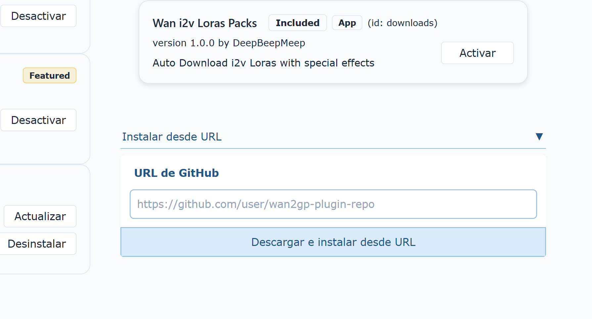

# WanGP Languages

Multilingual interface for WanGP with eight languages, versioned catalogs,
a translation editor and Weblate-ready files.

Version **0.2.0** is the first public release. This is an independent plugin;
WanGP catalog inclusion has not been requested or approved. Languages: Spanish, Catalan, the original English, French, Italian,
German, Russian and Simplified Chinese.

## WanGP compatibility

**Plugin 0.2.0 · tested with WanGP 19.292.** The plugin and WanGP use separate version numbers.

| Plugin version | Tested WanGP | Declared minimum | Other WanGP versions |
| --- | --- | --- | --- |
| 0.2.0 | 19.292 | 19.292 | Older and newer versions: unverified |

The `wan2gp_version` field in `plugin_info.json` declares a minimum of 19.292
for WanGP's plugin manager. It does **not** certify every later WanGP version.
19.292 is the only version tested for this release.

Check this table and the release notes when updating WanGP. Support will be
recorded as newer versions are tested; catalog or interface adjustments may be
needed. Each release records its tested version in the release notes and
[compatibility.json](compatibility.json).

## Usage

Activate the plugin, restart WanGP and open **More apps → Languages**. Choose
your language once; there is no floating selector. Disable interface translation
to restore English immediately. Preferences and corrections belong to this
browser and WanGP origin. Generation settings and user input remain unchanged.
Search inside WanGP's existing dropdowns uses their original English labels;
the translated caption returns when the field loses focus.

Use the built-in editor to search and correct a phrase, restore the bundled
translation or add another language. Export your corrections to back them up or
share them. Import previews show entries and conflicts; existing corrections
are preserved unless you explicitly replace them. The last import can be undone
without removing later edits. The plugin never submits contributions automatically.

The expanded catalogs were prepared with local model assistance and terminology
adjustments. Native-speaker review is still needed, especially for longer help
texts. Missing phrases fall back to English. Catalog coverage is not a guarantee
that every third-party app or every dynamic string is translated.

Catalogs are bundled JSON files. No model, GPU, online translator or Weblate
connection is needed to use the plugin. Same-origin embedded apps can be translated;
external frames, standalone apps that do not load the plugin, console output,
conversations and user-generated content are outside its scope.

WanGP's **Install from URL** option can install this
repository using its GitHub URL. Public catalog inclusion is a separate process.
For local installation, the folder is `plugins/wangp-language`.

## Install from inside WanGP

1. Open **Available Apps & Plugins / Apps & PlugIn Manager** in WanGP.
2. Expand **Install from URL** near the bottom of the manager.
3. Paste `https://github.com/SkriptorL/wangp-language` into **GitHub URL**.
4. Click **Download and install from URL** and wait for installation to finish.
5. Find **WanGP Languages**, enable it and restart WanGP.
6. Open **More apps → Languages**, choose your language and return to the generator.

There is no need to download a ZIP or copy files manually.
Use **Update** on the installed plugin's card to obtain later versions. Browser
preferences and corrections are retained; export corrections to keep a backup.
Installing from the URL does not require inclusion in WanGP’s public plugin catalog.

Future Weblate setup: JSON file format, English source, file mask `locales/*.json`,
monolingual base `locales/en.json`. Register additional locale names separately in
`languages.json`. Validate and review contributions before shipping a new version.
No Weblate project is connected yet.

See [the Spanish guide](README.md) for maintenance commands and detailed behavior.
Original plugin code is MIT licensed. Upstream WanGP text retains its own notices
and terms; see `THIRD_PARTY_NOTICES.txt` and `LICENSE.WanGP.txt`.
