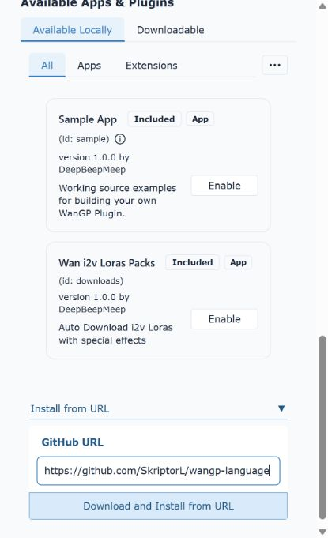

# WanGP Languages

Multilingual interface for WanGP with eight languages, versioned catalogs,
a translation editor and files prepared for Weblate.

**Plugin 0.2.0 · tested with WanGP 19.292.**

[Guía en español](README.es.md) · [Releases](https://github.com/SkriptorL/wangp-language/releases) · [Report a translation issue](https://github.com/SkriptorL/wangp-language/issues/new/choose)

Includes Spanish, Catalan, original English, French, Italian, German, Russian
and Simplified Chinese. This is an independent plugin. Inclusion in WanGP's
public plugin catalog has not been requested or approved.

## WanGP compatibility

The plugin and WanGP have separate version numbers.

| Plugin version | Tested WanGP | Declared minimum | Other WanGP versions |
| --- | --- | --- | --- |
| 0.2.0 | 19.292 | 19.292 | Older and newer versions: unverified |

The `wan2gp_version` field in `plugin_info.json` declares a minimum of 19.292
for WanGP's plugin manager. It does **not** certify compatibility with every
later WanGP version. **19.292 is the only version tested for this release.**

Check this table and the release notes when updating WanGP. Support will be
recorded as newer versions are tested; catalog or interface adjustments may be
needed. Each release records its tested version in its release notes and
[compatibility.json](compatibility.json).

## Installation

Install directly from WanGP's application and plugin manager:

1. Open **Available Apps & Plugins / Apps & PlugIn Manager** in WanGP.
2. Expand **Install from URL** near the bottom of the manager.
3. Paste `https://github.com/SkriptorL/wangp-language` into **GitHub URL**.
4. Click **Download and install from URL** and wait for installation to finish.
5. Find **WanGP Languages**, enable it and restart WanGP.
6. Open **More apps → Languages**, choose your language and return to the generator.



You do not need to download a ZIP or copy files manually. Later versions can
be installed with **Update** on the plugin's card. Browser preferences and
corrections are retained; export corrections to keep a separate backup.

Installing from a GitHub URL and appearing in WanGP's public plugin catalog
are separate processes. This repository can be installed directly. Catalog
inclusion depends on the WanGP maintainers.

For manual installation, put the repository contents in
`plugins/wangp-language`, enable the plugin and restart WanGP. `plugin.py` and
`plugin_info.json` must be at the root of that folder. Back up any local changes
before replacing an existing installation.

## Usage

Open **More apps → Languages**, select your preferred language and return to
your work. The choice is remembered for that browser and WanGP address. There
is no floating language selector, and the Languages section does not open
automatically on startup.

Uncheck **Enable interface translation** to restore the original English
interface immediately. Your preferred language is retained for re-enabling.

The catalogs ship with the plugin. Using it requires no model, GPU, online
translation service or Internet connection. It does not modify WanGP's core,
your prompts, paths, files or the values passed to the generator.

Dropdowns preserve their original values and show translated captions when
they are not being edited. Searching inside WanGP's existing dropdowns uses
their original English labels; the translated caption returns when the field
loses focus.

## Correct translations and contribute

Under **Correct a translation**, select a language, search for a phrase and
save your correction. You can restore the translation bundled with the plugin.
**Add a missing phrase** lets you add the exact text of an interface control
that is not yet in the catalog.

Corrections are stored in the browser's local storage. They are not a shared
account and do not synchronize automatically. Export your corrections to back
them up or share them with another contributor. Clearing browser data, changing
browsers or using a different WanGP address or port does not carry that local
copy over. Plugin updates retain the corrections stored in the browser.

Under **Add languages and share contributions**, you can:

- Create a language using its code and native name.
- Export only your corrections or a complete pack for the language selected
  in the editor. Untranslated phrases fall back to the original English.
- Preview and import a JSON pack. Existing local corrections win conflicts
  unless you explicitly choose to replace them.
- Undo the last import without deleting corrections made after that import.
- Export the monolingual JSON used by the planned Weblate workflow.

Imported packs are treated as text, never as HTML or executable code. Import
validation checks language codes, normalized duplicate phrases and placeholders
such as `{0}` before applying changes. The editor does not send files or
contributions automatically to GitHub, Weblate or other people.

To suggest a public correction, use the repository's **Translation correction**
issue template. Include the language, the WanGP and plugin versions, the exact
original phrase, where it appears, and your suggested translation. Leave out
personal prompts, paths and private content.

The expanded catalogs were prepared with a local model and terminology
corrections. **Native-speaker review is welcome**, especially for longer help
texts. These are not certified translations.

## Scope and limitations

The plugin translates matching interface text, help, integrated guides and
same-origin embedded applications. New or unrecognized phrases stay in English.
Conversations, prompts, gallery filenames, metadata and editable user content
are excluded. External applications, cross-origin frames, console output and
standalone applications that do not load the plugin are outside its scope.

The integration uses WanGP's `add_custom_js` API and preserves original text
so it can be restored. Its observer stops working when translation is disabled.
Future WanGP updates may require changes to catalogs or interface selectors.
The number of catalog entries is not a percentage of every string in WanGP.

## Maintenance

From the WanGP root, using the Python interpreter from its environment:

```text
python plugins/wangp-language/tools/catalog_tool.py validate
python plugins/wangp-language/tools/extract_sources.py --output language-inventory.json
python -m unittest discover -s plugins/wangp-language/tests
python plugins/wangp-language/tools/build_browser_test.py language-tests/index.html
```

The extractor reads application source and integrated guides. It requires
`markdown-it-py`, already used by WanGP's environment. Its output is a candidate
inventory to review before adding entries. It does not read personal photos,
configuration, conversations or generated output. Serve the browser test page
over local HTTP and click **Run tests**; the checks do not generate media.

Language codes and names live in `languages.json`; catalogs are
`locales/<code>.json`. `en.json` maps each English source phrase to itself.
Preserve source keys, placeholders, model names, paths and command syntax.
`tools/terminology.json` records terminology choices for this version.

Public documentation, release notes and contribution templates use English as
the primary language. Keep the separately linked Spanish guide up to date.

## Weblate: future connection

Catalogs use [Weblate's monolingual JSON format](https://docs.weblate.org/en/latest/formats/json.html).
**No Weblate project is connected yet.** When setting one up:

1. Create a component using this plugin's Git repository.
2. Choose **JSON file** format and **English** as the source language.
3. Use `locales/*.json` as the file mask and `locales/en.json` as the monolingual base.
4. Leave the new-language template empty to use the base file.
5. Register new languages in `languages.json`, outside the translation file mask.
6. Review contributions, run the checks and distribute them in a new plugin release.

WanGP will continue to use its bundled catalogs if Weblate is unavailable.

## License

Original plugin code is licensed under MIT; see `LICENSE`.
Texts originating from WanGP and their translations retain the rights and
notices of their source. See `THIRD_PARTY_NOTICES.txt` and `LICENSE.WanGP.txt`.
