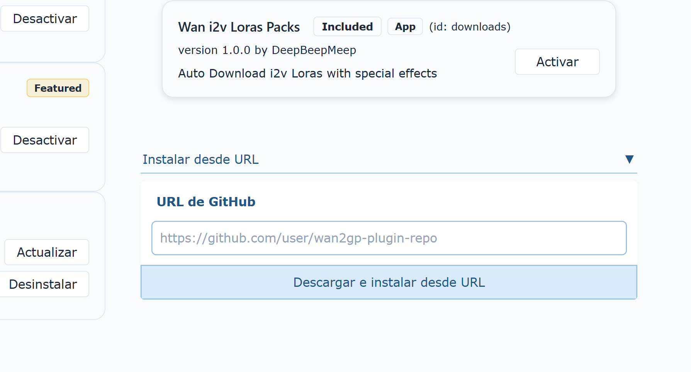

# WanGP Languages

Plugin de idiomas para WanGP. Versión **0.2.0**, primera versión pública.

[English guide](README.en.md)

Incluye español, catalán, inglés original, francés, italiano, alemán, ruso y
chino simplificado. Proyecto independiente: la inclusión en el catálogo oficial de
WanGP todavía no se ha solicitado ni aprobado.

## Compatibilidad con WanGP

**Plugin 0.2.0 · probado con WanGP 19.292.** Son dos números de versión distintos.

| Versión del plugin | WanGP probado | Mínimo declarado | Otras versiones de WanGP |
| --- | --- | --- | --- |
| 0.2.0 | 19.292 | 19.292 | Anteriores y posteriores: no verificadas |

El campo `wan2gp_version` de `plugin_info.json` declara el mínimo 19.292 para el
gestor de plugins. Este requisito **no certifica compatibilidad con todas las
versiones posteriores**. La única versión probada de esta entrega es 19.292.

Al actualizar WanGP, comprueba esta tabla y las notas de la versión del plugin.
Las nuevas versiones se incorporarán cuando se prueben; pueden requerir ajustes
en los textos o en la interfaz. Cada entrega conservará su versión probada en
las notas de lanzamiento y en [compatibility.json](compatibility.json).

## Uso

Activa el plugin en el gestor de aplicaciones y reinicia WanGP. Abre la sección
**Languages / Idiomas**, elige el idioma y vuelve a tu trabajo. La selección se
recuerda en ese navegador y dirección de WanGP. No aparece ningún selector flotante.
Desmarca **Activar la traducción de la interfaz** para recuperar el inglés
inmediatamente; el idioma elegido se conserva para volver a activarlo.

Los catálogos se distribuyen con el plugin. Usarlo no necesita un modelo, GPU,
servicio de traducción ni conexión a Internet. No modifica el núcleo, los prompts,
las rutas, los archivos ni los valores que recibe el generador. Los desplegables
conservan su valor original y muestran una etiqueta traducida cuando no se editan.
La búsqueda dentro de los desplegables propios de WanGP utiliza sus nombres
originales en inglés; al salir del campo vuelve a mostrarse la etiqueta traducida.

## Corregir y colaborar

En **Corregir una traducción**, elige el idioma que quieres editar, busca una frase
y guarda la corrección. Puedes restaurar la versión incluida con el plugin.
**Añadir una frase que falta** permite incorporar el texto exacto de un control
que todavía no figure en el catálogo.

Las correcciones se guardan en el almacenamiento local del navegador. No son una
cuenta compartida ni se sincronizan automáticamente. Exporta las correcciones para
conservar una copia y enviarla a otro colaborador. Borrar los datos del navegador,
cambiar de navegador o usar otra dirección/puerto de WanGP no conserva esa copia local.
Las actualizaciones del plugin mantienen las correcciones del navegador.

En **Añadir idiomas y compartir aportaciones** puedes:

- Crear otro idioma con su código y nombre propio.
- Exportar sólo tus correcciones o un paquete completo del idioma seleccionado
  en el editor. Las frases sin traducción usan el inglés original.
- Previsualizar e importar un paquete JSON. Por defecto se conservan tus
  correcciones cuando hay conflictos; reemplazarlas es una elección explícita.
- Deshacer el último importado sin eliminar las correcciones que hayas hecho
  después de importarlo.
- Exportar el JSON monolingüe que utiliza el futuro flujo con Weblate.

Los paquetes se interpretan como texto, nunca como HTML o código. La importación
valida códigos, entradas duplicadas y marcadores como `{0}` antes de aplicarse.
El editor no envía archivos ni propuestas a GitHub, Weblate u otras personas.

Los catálogos ampliados se han preparado con asistencia de un modelo local y
ajustes de terminología. Necesitan revisión de hablantes de cada idioma, sobre
todo las ayudas largas. No deben presentarse como traducciones certificadas.

## Instalación desde repositorio

Se instala desde el propio gestor de WanGP, en la sección que muestra esta captura:



1. Abre **Available Apps & Plugins / Gestor de aplicaciones y plugins** en WanGP.
2. Baja hasta **Instalar desde URL** y despliega la sección.
3. Pega `https://github.com/SkriptorL/wangp-language` en **URL de GitHub**.
4. Pulsa **Descargar e instalar desde URL** y espera a que termine.
5. Busca **WanGP Languages**, pulsa **Activar** y reinicia WanGP.
6. Abre **Más aplicaciones → Idiomas**, elige tu idioma y vuelve al generador.

No hace falta descargar un ZIP ni copiar archivos a mano.
Las versiones posteriores se podrán obtener con **Actualizar** en la ficha del
plugin instalado desde GitHub. La elección de idioma y las correcciones guardadas
en el navegador se conservan; exporta tus correcciones para tener también una copia.

La instalación por URL y la inclusión en el catálogo público son procesos
diferentes. Puedes instalar este repositorio directamente; aparecer en la lista
de plugins descargables de WanGP depende de sus responsables.

El paquete contiene `plugin.py` y `plugin_info.json` en la raíz, como requiere
el gestor de WanGP. Para una instalación manual, coloca su contenido en
`plugins/wangp-language`, activa el plugin y reinicia. Guarda tus cambios locales
antes de reemplazar una instalación existente.

## Alcance y mantenimiento

Se traducen textos de la interfaz, ayudas, guías integradas y aplicaciones
incrustadas del mismo origen cuando coinciden con el catálogo. Las frases nuevas
o no reconocidas mantienen el inglés. Se excluyen conversaciones, prompts,
nombres de archivos de la galería, metadatos y contenido editable del usuario.
Las aplicaciones externas, los iframes de otro origen, la consola y una aplicación
independiente que no cargue el plugin quedan fuera de este mecanismo.

La adaptación utiliza la API `add_custom_js` de WanGP y conserva los originales
para restaurarlos. El observador deja de trabajar al desactivar la traducción.
Una futura actualización de WanGP puede requerir actualizar catálogos o selectores.
El número de entradas del catálogo no equivale a un porcentaje de toda la aplicación.

Desde la raíz de WanGP, usando el Python de su entorno:

```text
python plugins/wangp-language/tools/catalog_tool.py validate
python plugins/wangp-language/tools/extract_sources.py --output language-inventory.json
python -m unittest discover -s plugins/wangp-language/tests
python plugins/wangp-language/tools/build_browser_test.py language-tests/index.html
```

El extractor sólo lee fuentes de la aplicación y guías integradas. Requiere
`markdown-it-py`, ya utilizado por el entorno de WanGP. El resultado es un
inventario de candidatos que debe revisarse antes de incorporarlo. No lee fotos,
configuración personal, conversaciones ni salidas generadas. La página de pruebas
se sirve por HTTP local y se ejecuta con **Run tests**; no genera contenido.

Los códigos se registran en `languages.json`; los archivos están en
`locales/<código>.json`. `en.json` contiene cada frase fuente como clave y valor.
Conserva las claves y los marcadores, nombres de modelos, rutas y comandos.
`tools/terminology.json` recoge decisiones de terminología de esta versión.

## Weblate, conexión posterior

Los catálogos usan el formato [JSON monolingüe de Weblate](https://docs.weblate.org/en/latest/formats/json.html).
La conexión todavía no existe. Cuando se configure el proyecto de traducción:

1. Crear un componente con el repositorio Git del plugin.
2. Elegir formato **JSON file**, idioma fuente **English**.
3. Máscara: `locales/*.json`; base monolingüe: `locales/en.json`.
4. Dejar vacía la plantilla de nuevos idiomas para usar el archivo base.
5. Registrar los idiomas nuevos en `languages.json`, fuera de la máscara traducible.
6. Revisar las aportaciones, ejecutar las pruebas y distribuirlas en una nueva versión.

WanGP seguirá funcionando con sus catálogos locales si Weblate no está disponible.

## Licencia

El código original de este plugin se ofrece bajo MIT, según `LICENSE`.
Los textos procedentes de WanGP y sus traducciones conservan los derechos y avisos
de su origen; véanse `THIRD_PARTY_NOTICES.txt` y `LICENSE.WanGP.txt`.
